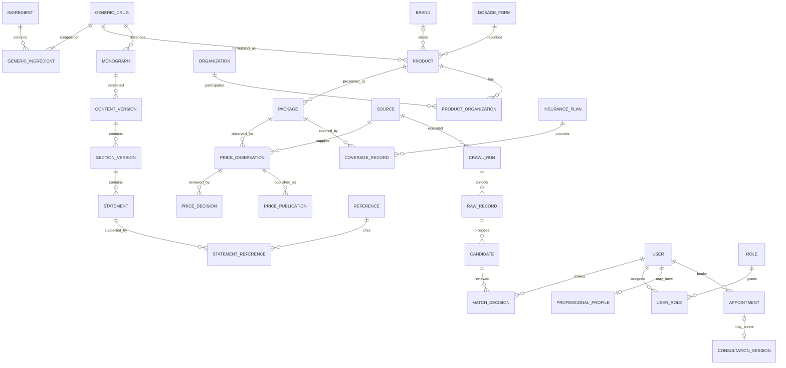

# Proposed entity relationships

Illustrative conceptual ERD, not an implemented schema. Junctions represent many-to-many, not copies of entities. See [schema](DATABASE_SCHEMA.md) for optional fields and constraints.

Identifiers can refer to different evidence-supported scopes; a package may have several identifiers and the same scheme may have conflicting source assertions. `professional_profile` is at most one per user here; professional verification records may be many. Consultations and insurance are future concepts, not active services.
