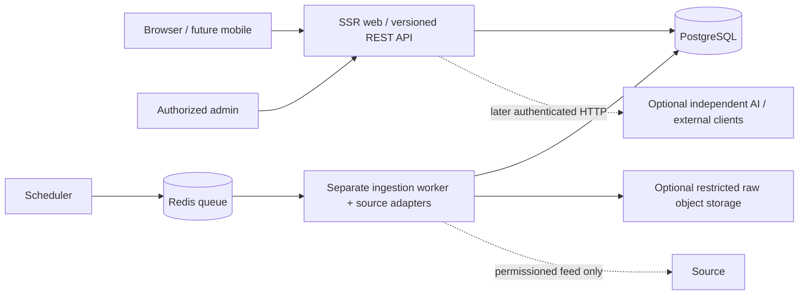

# System architecture

**Current:** Django SSR and a small catalog/search and presentation-detail slice run locally on SQLite. Search and detail share public eligibility checks, but no clinical or source-rights approval exists. The development-only staff portal uses Django authentication and sessions, scoped view/add/review permissions, separate product and price candidate staging and preliminary review events; it is disabled outside debug mode. This is not an approval or tamper-proof audit system and SQLite concurrency limitations apply. There are no workers or production services yet. **Target architecture below is proposed:** a modular monolith with PostgreSQL transaction boundaries and separate operational processes, not premature microservices.

## Boundaries

- **Catalog** owns ingredient, generic formulation, brand, product, package, identifier and organization relationships. **Clinical** owns monographs, statement/evidence links, versions and reviews. **Pricing** owns observations and published decisions. **Ingestion** owns source policies, raw references, runs, checkpoints and candidate matching. **Identity/audit** owns access and decisions. A separate **consultation** domain is reserved, disabled and not a dependency of public reading.
- Public controllers query approved projections only; draft, raw, PHI and administrative tables are not public. Domain services enforce workflows even when called through admin. DB constraints protect identity and append-only audit/history; scoped transactions make approvals atomic.
- A separate worker process imports adapters behind common contracts. Neither schedule nor crawl is triggered by public requests. Jobs have explicit run IDs and idempotency keys. API/worker independently deployable as processes from one codebase; future services integrate via versioned APIs, not direct database access.
- Redis is an operational dependency only after queues are implemented. Database is authoritative; cached public views are invalidated on approval/withdrawal, with bounded TTL. A cache/queue outage must not delete data or cause publication. Object storage is introduced only if authorized raw documents/images justify it.

## Future consultation and AI

Separate records and permissions, encryption/key management, consent, professional verification, safe file uploads, retention and explicit legal sign-off before activation. Use a vetted real-time provider or isolated communications service after threat assessment; don't record by default. An AI gateway may retrieve only approved, permission-appropriate content with references; it is not needed by the core and cannot mutate published records. External app integrations use REST/OpenAPI and scoped credentials; event delivery can be added via a transactional outbox after demonstrated need.

## Operational isolation

Reverse proxy → web processes → PostgreSQL; dedicated scheduler and constrained workers → queue, database and permitted sources. Workers have separate credentials, concurrency and resource limits. Web health does not depend on source availability. Monitoring, audited backups and restore drills precede production. Actual implementation must make architectural deviations explicit through ADRs.
